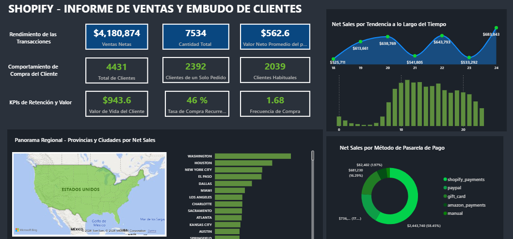

# 📊 Análisis de ventas, Comportamiento y Embudo de Clientes de Shopify 

## Contexto del Proyecto

Desarrollé este proyecto para analizar las compras y el comportamiento de 4,431 clientes de una tienda Shopify. El dashboard muestra el rendimiento por método de pago, categoría de producto, ubicación geográfica (mapa regional y ranking de ciudades) y patrones de tráfico por día y hora. Está pensado para ayudar a que los equipos de operaciones y marketing encuentren los mercados con mayor conversión, mejoren la retención de clientes recurrentes y ajusten los horarios de mayor venta.

Dividí a los clientes en compradores únicos y habituales. Relacioné las ventas netas con la pasarela de pago, la categoría de producto, la ubicación y la marca de tiempo, que incluye el día y la hora, durante una ventana de 7 días, del 18 al 24. 

## 🛠️ Herramientas Utilizadas

- Excel: Limpieza y transformación de datos con Power Query.

- DAX (Data Analysis Expressions): Creé medidas dinámicas para calcular métricas de rendimiento transaccional, comportamiento del cliente (Lifetime Value, tasa de compra recurrente, frecuencia de compra) y lógica de selección de medidas.

- Power BI: Creé un panel de control interactivo que muestra mapas de densidad geográfica, gráficos de tendencia temporal, pasarelas de pago y filtrado cruzado dinámico entre visualizaciones. 

Analicé el conjunto de datos de transacciones de Shopify. Me enfoqué en el rendimiento por región, por periodos de tiempo y por tipo de cliente. Clasifiqué a los usuarios en compradores únicos y compradores habituales para ver métricas de retención como el LTV ($943.6) y la frecuencia de compra (1.68). Después, agrupé las ventas netas por pasarelas de pago, categorías de productos y ubicaciones como estados y ciudades en EE. UU. Crucé estos datos con las marcas de tiempo por día y hora para encontrar los momentos con mayor conversión operativa.

## Conclusiones Principales 

- Dominio de la categoría principal: Las líneas de calzado deportivo, como Running Shoes, Tennis Shoes y Walking Shoes, generan la gran mayoría de los $4.18M en ventas netas totales. Categorías como accesorios o prendas secundarias representan una porción mínima del volumen comercial.

- Oportunidad en la retención de clientes: Aunque hay una tasa de recurrencia notable del 46% (2,039 clientes habituales), el 54% de la base total de clientes (2,392 de 4,431) ha hecho solo un pedido. Esto muestra que hay mucho espacio para aumentar la lealtad de compra.

- La mayoría de las transacciones ocurren en solo dos canales de pago. Shopify Payments tiene el 58.45% y PayPal el 16.29%. En conjunto, casi el 75% de las transacciones pasan por estas dos opciones.
 
- Picos temporales de conversión: Las transacciones cambian su comportamiento en días concretos del mes. También hay concentraciones claras de tráfico en ciertas franjas horarias. Esto permite prever los momentos de mayor volumen operacional.
